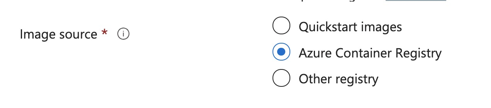
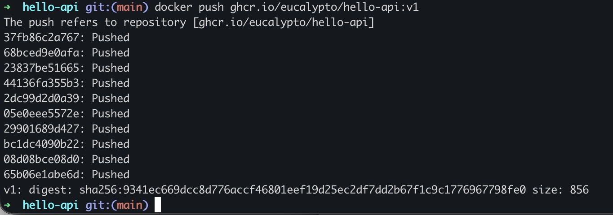
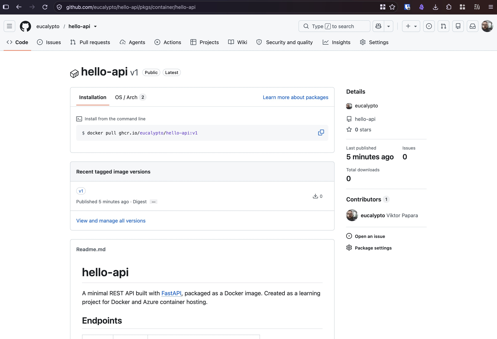
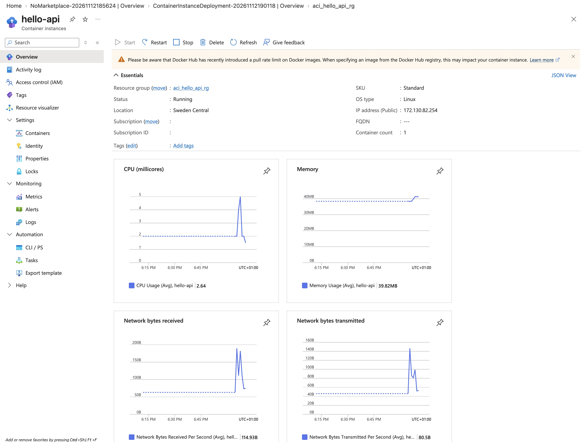
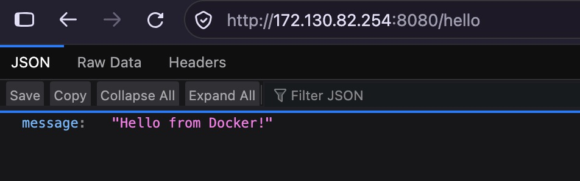
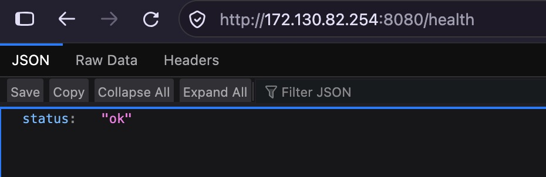
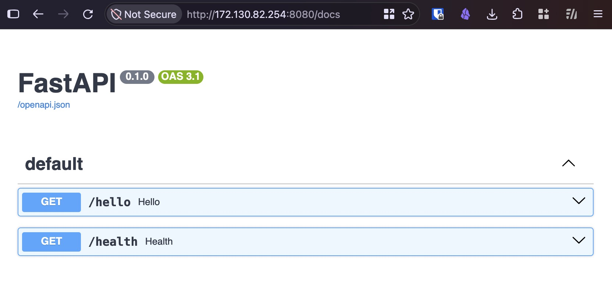
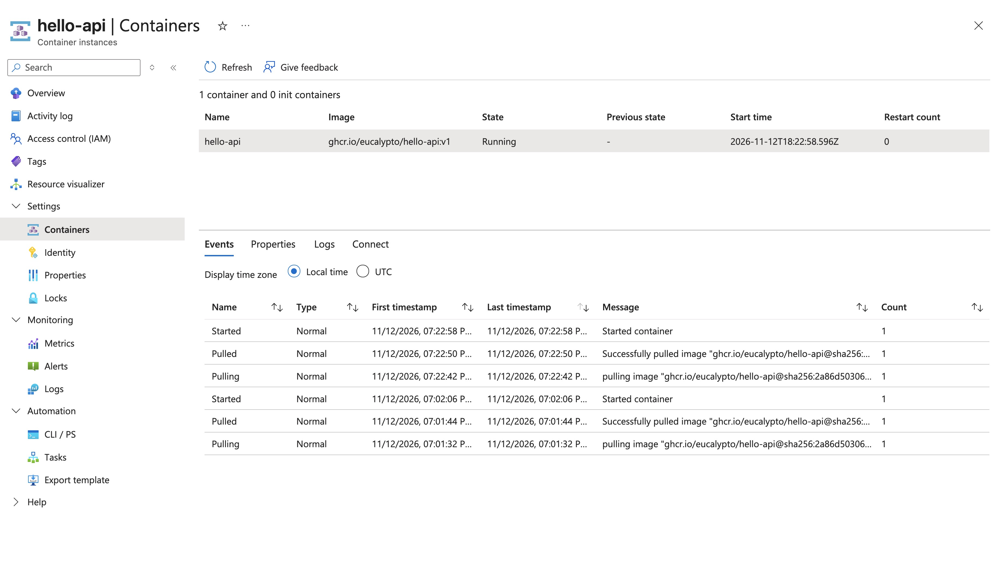

# Azure Container Instances (ACI) Setup

**Certification:** AZ-104  
**Module:** [Module name]()  
**Date completed:** 2026-10-DD  

## Scenario

> From the previous step, I [set up a local docker container development environment](../../../bare-metal/2026-11-10%20Setup%20Docker%20Development%20Environment/). Now I want to explore deployment options in Azure, starting with Azure Container Instances (ACI)


## What I Did

Azure Container Instances (ACI) is the easiest way to deploy a Docker container app. There are other options like Azure Container Apps or App Service, or Azure Kubernetes Service (AKS). They offer more features like auto scaling and I want to get to know them all, but one has to start somewhere.

Learning: ACI offers only three image source options:



There is no option to manually upload a container. So the choice is only between the different container registries.

I considered those options:
- Azure Container Registry
- Docker Hub
- GitHub Container Registry (GHCR)

For this task I chose Github Container Registry. It is free of charge for my use case. Azure Container Registry does have an hourly cost, and Docker Hub has strict pull rate limits that are bond to the IP address so ACI's shared IP addresses for pulling migth trigger this limit quickly.


For GitHub Container Registry, there are two main ways to be used:
- A: Manually, using the docker CLI and a personal access token (classic)
- B: Github Actions that uses built-in Github Tokens

Here I want to do the manual route once, so that I see it once.

So I've created a classic Personal Access Token (PAT) and successfully registered it in my local docker CLI.

The next step is to build the image and upload it. This step created a small problem: Since my hardware is a Macbook with an arm64 CPU, the Ubuntu VM is also arm64, but Azure Container Instances run on amd64. So I have to specify this in

```
docker build --platform linux/amd64 --label org.opencontainers.image.source=https://github.com/eucalypto/hello-api -t ghcr.io/eucalypto/hello-api:v1 .
```

But this produced an error because of the arm64/amd64 issue. To solve this I played emulation-Inception by registering a x86 emulator in the emulated Ubuntu VM's kernel. One more reason to quickly switch to github actions since it uses amd64 by default.

The build with the emulated amd64 took several minutes, and I updoalded it with docker CLI:



Images uploaded this way are private by default, so I had to manually set it to public and also manually link it to the hello-api GitHub repository (this can be done also with an extra line in the Dockerfile). So now the fancy page for this pasckage on GitHub looks like this:



I also checked that I can pull this image now without being logged in with my GitHub PAT.


The next big step is to crete an ACI instance that pulls the image and runs it. It worked perfectly using the now public URL of the container on ghcr.io



And those nice usage peaks come from me trying the public ip where the container runs:






And the docs (that one would (partially) hide in a production system) work as well:




After the first start, I stopped the container instance and restarted it again and from the container logs one can see that the ACI pulls the image on every start. 



This is the way of updating the app, since even with a github action build, the github action does not automatically toggle the ACI to pull and start the new image.

## Gotchas & Learnings

- **"Problem":** For just wanting to deploy a single container image, there were quite a few steps to do.    
    **Takeaway:** This is not really a problem, but the nature of setting up a new deployment pipeline. All the steps, accounts, and tokens need to be set up.
   

## Next Steps

The next steps will be to set up a github action build pipeline. This will make the build and upload into the container registry automatic and far less error prone. Also I won't have to deal with local vs cloud architecture differences.

Also I want to deploy this in the other Azure ways like Azure Container Apps or Azure Kubernetes Service (AKS).
