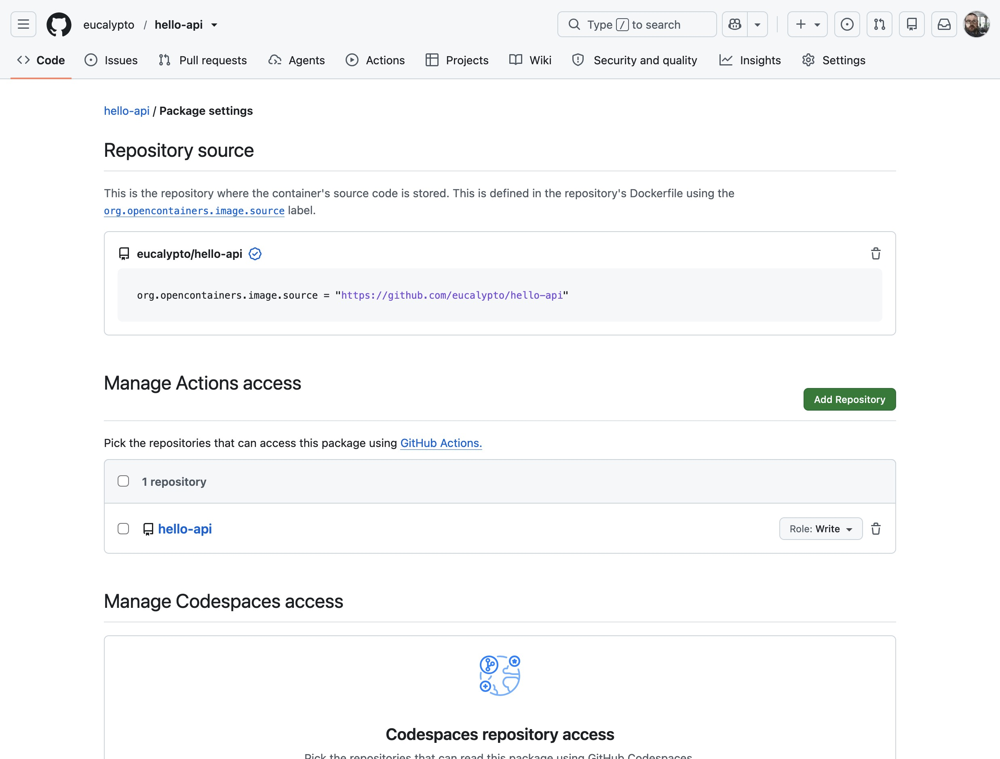
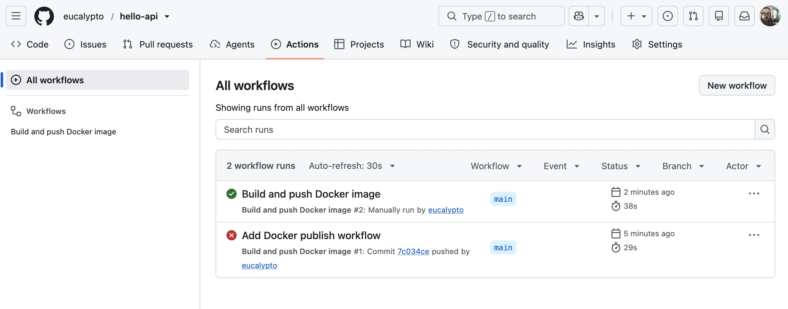

# Add GitHub Actions Build Workflow for hello-api

**Date completed:** 2026-11-13  

## Scenario

> In the [previous project](../../Azure/projects/2026-11-12%20Azure%20Container%20Instances%20setup), I build and uploaded the hello-api Docker image manually to GitHub Container Registry and then let it get pulled from there by Azure Container Isnstances for deployment. Now I want to automate the process of building and pushing the Docker images via GitHub Actions in a CI/CD style.

## What I Did

I created the workflow in the repository: `.github/workflows/docker.yml` and pushed it.

The first run did fail with an `permission-denied` because I already created a package repository manually, I had to give this code repository write permissions to the package repo:

and then I could trigger the action from the website and it did successfully run:

Now I have two packages, the first one uploaded manually, and now this second one uploaded by the github action.

I changed the tagging from "v1" to the hash of the git commit so that the version is uniquely named and one can easily track the exact git commit. This is meant to prevent faulty tags like "v1", when the tag changes to another version without being noticed.

Now I have a working build and upload workflow for the Docker image.
