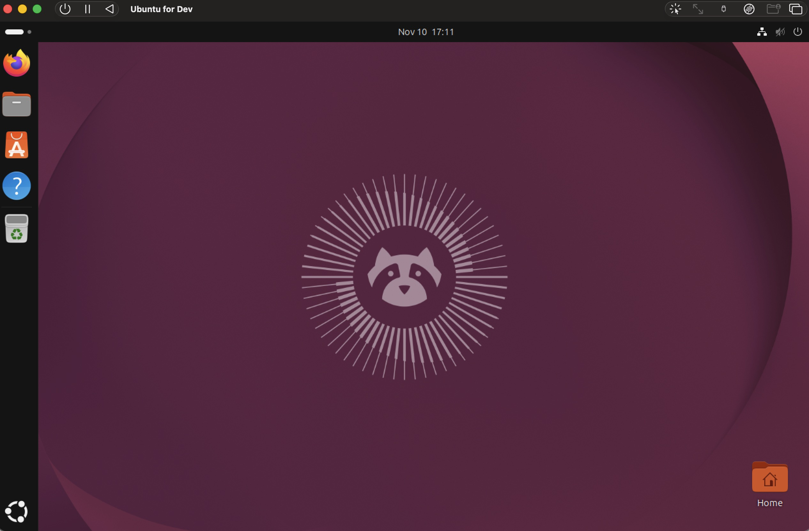
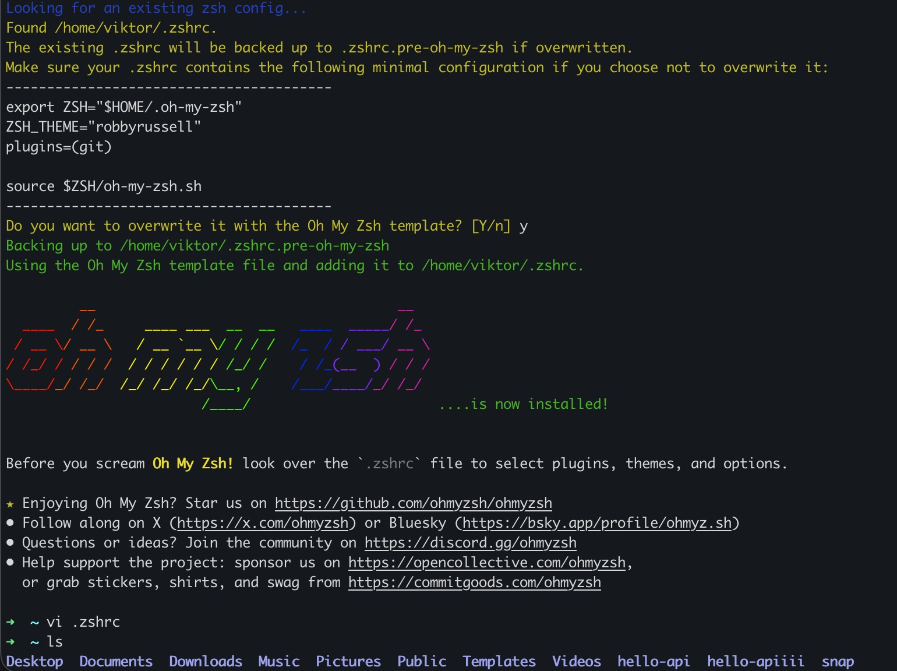
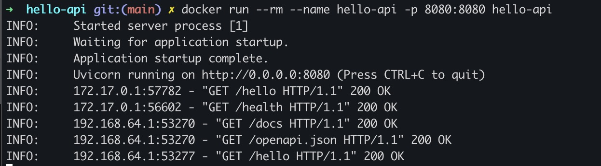
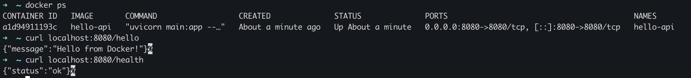
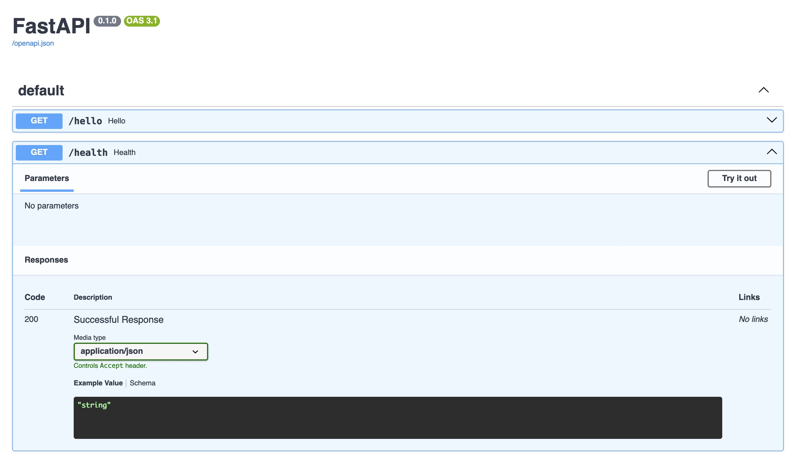

# Setup Docker Development Environment

**Date completed:** 2026-11-10

## Scenario

> I wanted to set up a Docker development environment so that I can create docker images that then will get deployed in Azure.

## What I Did

I work on a mac but wanted to set up an Ubuntu environment because I'm more used to "full" Linux, So I set up a VM with UTM:

The next setup steps were:
- update all ubuntu packages
- add mac ssh public key and disable password login -> ssh only possible with an ssh key

I also installed and set up zsh (And Oh My Zsh) instead of bash, because I'm using this setup on my mac:

Then I installed docker engine according to https://docs.docker.com/engine/install/ubuntu/#install-using-the-repository
I decided against docker desktop because for companies it is a licensed product, so I wanted to not rely on it.

Then I created the hello-api app using Python FastAPI and uvicorn and packaged it into a docker image. That can run locally:

And to check if it really runs, I did some curl commands:

FastAPI also creates a nice docs page that documents the API:

The next step was to push this state to a GitHub repository: https://github.com/eucalypto/hello-api

## Gotchas & Learnings
    
- **Learning:** Docker caches the build steps  
    **Takeaway:** The commands in the Dockerfile during `docker build` are executed one after the other and cached as layers. One of the last steps is to copy the app itself, so if I change it and run docker build, only this step needs to be fully executed, all previous steps are taken from cache. This speeds up the build process.

## Next Steps

The next step will be to deploy this hello-api app to Azure. There are several options for this, and I will start with Azure Container Instances (ACI).
